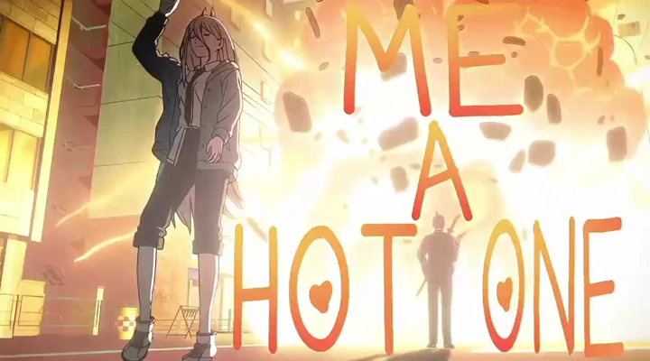
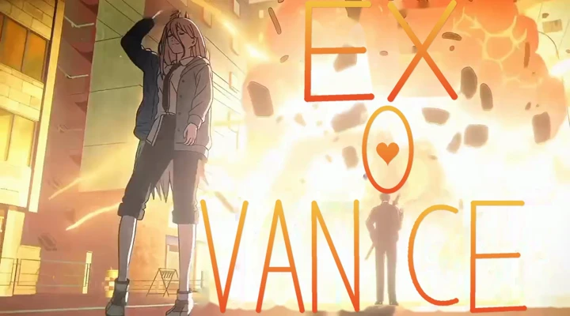

<p align="center"></p>

<h1 align="center">Exovance Video Director</h1>

<p align="center"><strong>Монтаж эдитов, анимация подписи и замена текста внутри кадра</strong></p>

<p align="center">
<a href="#примеры">Примеры</a> ·
<a href="#быстрый-старт">Быстрый старт</a> ·
<a href="references/gpt-video-stack.md">Инструменты для GPT/Codex</a>
</p>

## Примеры

### «Человек-бензопила» · титр внутри сцены

Около девятой секунды надпись в кадре заменили на **EX / O / VANCE**, сохранив огненный цвет, вертикальную композицию и момент появления. В отдельной правке освободили правую стойку буквы **N**, которую закрывал персонаж.

| Исходник · 00:10.05 | После · 00:10.05 |
| --- | --- |
|  |  |

[Посмотреть крупный план N и другие разборы →](docs/cases.md)

### Что умеет проект

| Задача | Что получаешь |
| --- | --- |
| Разобрать исходник | Кадры для проверки, параметры видео и звука, кандидаты на музыкальные акценты и надписи с таймкодами |
| Поставить подпись Exovance | MP4 с одной полупрозрачной подписью, заданной позицией и временем появления |
| Сделать необычную правку | Пробный фрагмент с заменой текста на стене, перекрытием персонажем или анимацией букв, затем проверенный экспорт |
| Собрать эдит с музыкой | Правила подбора трека под сцену, черновой таймлайн и проверка попадания склеек в музыкальные акценты |

[Инструкция для агента](SKILL.md) · [Решения для неполного брифа и проверка качества](references/edit-decisions.md) · [Пресеты и разборы](references/brand-and-lessons.md)

## Быстрый старт

В ChatGPT или Codex приложи ролик и опиши результат своими словами. Например, «замени WSP на стене, а полупрозрачный Exovance выведи снизу по центру с девятой секунды». Ассистент разбирает сцены, подбирает технику, монтирует, анимирует и проверяет экспорт. Если место и время подписи уже указаны, можно сразу приступать к работе.

В Codex открой этот репозиторий как рабочую папку. Правила работы находятся в [AGENTS.md](AGENTS.md), а правила монтажа и анимации — в [SKILL.md](SKILL.md).

Для локального запуска скриптов нужны Python 3.10+, `ffmpeg` и `ffprobe` в PATH. В сборке FFmpeg должны быть доступны `drawtext` и `libx264`. На Windows вместо `python` можно использовать `py`, а путь к шрифту для подписи задать через `--font`.

```sh
python -m pip install -r requirements.txt
python scripts/media_audit.py input.mp4 --out-dir work/audit --frames 8
python scripts/watermark_export.py input.mp4 exports/Exovance.mp4 --start 9 --fade 0.7 --position bottom-center --opacity 0.35 --fps 60
```

Пример плавно вводит подпись на девятой секунде и сохраняет её до конца. Скрипт использует размер исходного кадра. Шрифт можно задать через `--font`. Чтобы убрать подпись к нужному моменту, укажи время её исчезновения через `--end` и длительность затухания через `--fade-out`.

Для лёгкого движения вверх и короткого блика добавь `--effect soft-glint`. Положение и размер рассчитываются по отображаемой ориентации, в том числе для роликов с поворотом в метаданных.

Если в кадре могут быть пропущенные надписи, скрипт умеет искать их по выборочным кадрам. Для этого нужен Tesseract в PATH с установленным языком распознавания.

```sh
python scripts/media_audit.py input.mp4 --out-dir work/audit --frames 20 --ocr
```

Слова, координаты и таймкоды выборок появятся в `audit.json`. Для другого установленного языка укажи `--ocr-language`, например `eng+rus`. Находки сверяются с кадрами перед любыми правками.

Чтобы разобрать короткую вспышку или надпись около 12-й секунды, добавь `--frames-from 11.7 --frames-to 12.3`. В отчёте сохраняются таймкоды исходного ролика.

В работе над новым роликом уточни, нужна ли подпись весь ролик или в отдельный момент и где её поставить, если этих указаний ещё нет. Превью сложной сцены проверяй в движении. Целевой экспорт по умолчанию — **1080p / 60 FPS** с сохранением формата кадра. Для 4K или апскейла сверяй исходный размер и оговаривай, что действительно получилось на выходе.

## Проверка проекта

В Linux со шрифтом DejaVu Sans и английской моделью Tesseract запусти `python tests/smoke_test.py`. Проверка сверяет OCR, время появления подписи, движение, блик, ориентацию, 60 FPS, звук и декодирование MP4. [Конфигурация GitHub Actions](.github/workflows/check.yml) запускает эту проверку при изменениях в `main` и pull request в эту ветку.

## Что развивать дальше

1. **Анимация бренда.** Собрать в HyperFrames переиспользуемый титр с плавным появлением букв. Remotion проверить на шаблоне с двухцветной заливкой и прозрачным слоем.
2. **Надписи в сцене.** Проверить привязку букв к стене через OpenCV на отрезке с движением камеры и перекрытием персонажем.
3. **Монтаж под музыку.** Сохранять тайминги сцен и акцентов при сборке в FFmpeg, чтобы можно было точечно обновить склейку или эффект.

[Репозитории 50 000+ звёзд и как я использую их в монтаже →](references/gpt-video-stack.md)
