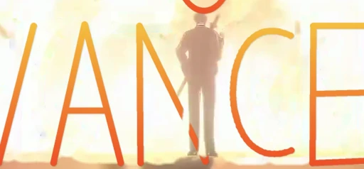
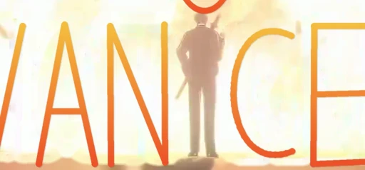
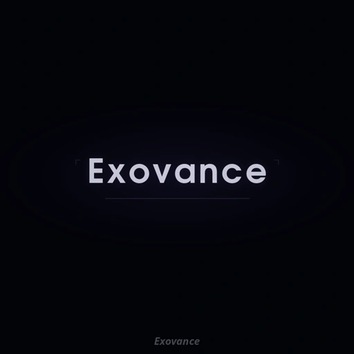
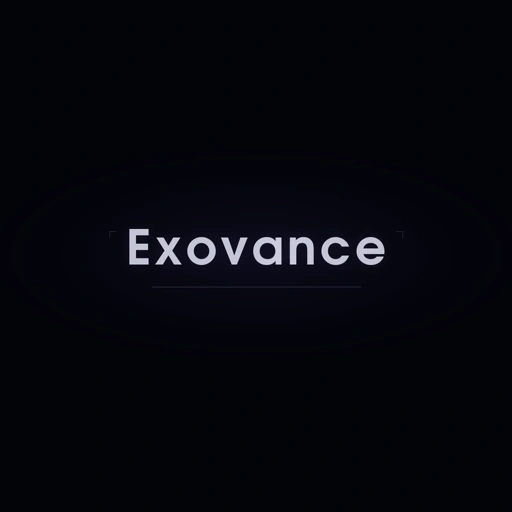

# Разборы монтажных правок

[← На главную](../README.md)

## «Человек-бензопила» · читаемость N

**Задача.** Заменить крупные слова в сцене около 00:09 на **EX / O / VANCE**. Сохранить порядок появления групп, оставить сердце внутри **O** и вписать буквы в свет от вспышки.

**Правка.** В первой версии персонаж закрывал правую стойку **N**, отчего слово читалось плохо. В исправленной версии **N** читается целиком, а персонаж остаётся между **N** и **C**.

| Первая версия · 00:10.05 | Исправленная версия · 00:10.05 |
| --- | --- |
|  |  |

**Проверка.** Просмотреть начало появления и кадр после вспышки. На обеих точках проверить границы букв, силуэт и читаемость каждой группы.

## 2B · одна подпись в финале

**Задача.** Около 00:18 начинается участок с крупной финальной надписью. Во время заставки убрали нижнюю подпись, чтобы на экране остался один **Exovance**.

| Первая версия · 00:19.23 | Исправленная версия · 00:19.23 |
| --- | --- |
|  |  |

**Проверка.** Сравнить момент перехода и несколько кадров заставки. Нижний знак должен уйти к началу крупного титра.

## WSP → EXOVANCE · надпись на стене

Сценарий из переписки для отдельной проверки на исходном видео.

1. Найти отрезок, где видна старая надпись. По чистому кадру или маске подобрать восстанавливаемую фактуру стены.
2. Привязать **EXOVANCE** к плоскости. Подстроить перспективу, свет и резкость. Если объект проходит перед стеной, добавить маску перекрытия.
3. Просмотреть участок при движении камеры. Проверить, держатся ли буквы на стене и исчез ли след старого текста.
4. Добавить нижнюю подпись в следующей части ролика, если именно так поставлена задача.

## ZAPPER · непонятная надпись

Если назначение слова неясно, показать кадр или назвать слово, время и место. Пример вопроса для отметки 00:12: «Внизу вижу ZAPPER. Это чужой ник, который заменить на Exovance, или часть текста, которую оставить?» Собрать спорные места в один вопрос и продолжить остальные правки, пока ждёшь ответа.

## Доума и Шинобу · цветной финал

**Запрос.** Чёрный фон, две цветовые половины одного **Exovance** под персонажей, согласованная по цвету нижняя подпись. Для новой версии подобрать две палитры из самих кадров, плавно проявить буквы и проверить читаемость обводки на чёрном фоне.
